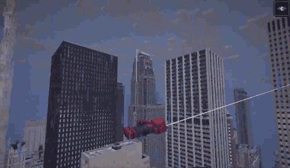

# Spider-Man for Horizon



Web swinging, zips, wall running and parkour for [Horizon](https://github.com/horizon-rust/horizon), Minecraft: Java
Edition rewritten in Rust. Tuned against Marvel's Spider-Man 2 gameplay: momentum carries from swing to swing, walls
are floors, rooftops are runways.

A native Horizon mod, built from source by the Horizon launcher, plus a WebAssembly build of the same code. Fan-made.
Not affiliated with Marvel, Sony Interactive Entertainment, Insomniac Games, Mojang or Microsoft.

## Play it

You need the Horizon launcher **0.2.23 or later** and a Microsoft account that owns Minecraft: Java Edition.
Tested on macOS.

```sh
horizon-launcher update        # then restart the launcher
horizon-launcher prepare       # the game's resources, from your Minecraft install
git clone https://github.com/wyddy7/minecraft-spider-man-rust
horizon-launcher native-build minecraft-spider-man-rust/native/mixins/spider-man --trust-native-code
```

The first build downloads the launcher's own Rust (about 450 MB, once) and Horizon's source, then compiles
the game: on an Apple M5 it took under 5 minutes, about 3 GB of disk in all. It becomes the **Native mods**
instance in the launcher: pick it, press Play, press **F5** for third person, find something tall, hold **R**.

Native mods are experimental in Horizon and **not sandboxed**: the code runs with your rights, which is why the
launcher asks for `--trust-native-code`. The whole mod is in [`native/mixins/spider-man/`](native/mixins/spider-man/);
read it first. The mod is made for Horizon v0.2.96, and the launcher builds exactly that version from source,
whatever version you play otherwise, in an instance of its own. More in
[native/README.md](native/README.md#install-with-the-horizon-launcher).

## Controls

| Input | Does |
|---|---|
| hold **R** | web: it flies for a moment, then a pendulum swing over the street; A/D lean the anchor to a side, W pumps. On the ground with an anchor in reach it jumps into the swing |
| release **R** | let go: a boost (more on the upswing), a forward flip, a spread-eagle fall |
| hold **Z** | zip to the crosshair (reach 250), riding an arc to the point and hanging there while Z is held; let go to hop on |
| **Space** | on a web: held swings faster, let go jumps off · on a zip: held hauls, let go jumps off · at the zip point: launch · on a wall: kick off |
| into a wall with **R** held | on the wall: WASD walk it like a floor, relative to the camera; sprint runs; nothing held clings; the top edge is vaulted |
| **W** into an obstacle | parkour by its height: a step or speed vault (1 block), a hand vault (2), a run up the face (3–5); long tops are landed on and run across |

A chase camera follows the swing and shakes at speed; the wind gets louder the faster you go. Falls from a swing
don't hurt.

Chat: `/swingmode on|off` switches the mod; `delay 0..2` (how long a web flies before it bites, 0.5 by default) and
`jump on|off` (jumping into a swing from the ground) are its settings, kept between games; `view side|front|back|off`
gives a fixed camera for looking at the poses; `debug` prints what the mod sees.

It plays in single player and in a LAN world you host. On someone else's server it does nothing: it only moves the
player where the server is yours. A city map makes the most of it; for the look, any Spider-Man skin.

## Status

0.2.0 in progress. The native build has everything above. Not yet: rebinding R and Z (keys are fixed), a settings
page in Options (the chat settings stand in), and the wall-as-floor camera roll on tall walls, which a native mod
can't do on Horizon yet (it stays in the development build). Multiplayer on servers is the plan, the way movement
mods do it: the server runs the mod too and lets its players swing.

## For mod authors

Horizon's native mods are new, and its documentation covers the tooling: [horizon-mixins](https://github.com/horizon-rust/horizon-mixins)
and its [template](https://github.com/horizon-rust/horizon-native-mod-template). This repository is a working mod
that goes past the template's one hook; things it shows that aren't written down there:

- **Drawing in the world.** The web strands are a HEAD hook on the game's lead (leash) geometry pushing quads into
  the same vertex list; the posed player model is a cancellable HEAD on `player_model_geometry` that draws the body
  itself through the public `mobs::anim` and `mobs::render` API and leaves every other case to the game.
- **Live reload while developing.** A native mod is compiled into the game, but `forbid(unsafe_code)` binds only
  the crate that declares it: a small dev-only crate loads the mod's logic as a library and reloads it when it
  changes. Edit, save, and the running game has it in about a second. The shipped bundle compiles the same logic in.
- **Porting a WebAssembly mod unchanged.** A facade with the mod SDK's names serves the SDK calls from the hooks'
  data, so the existing `src/` builds as either.
- **Hook targets that work.** horizon-mixins' rules (no HEAD over a body with a macro, no BEFORE_CALL in one with
  `?`, no RETURN in one with a closure) rule out many of the game's obvious functions, the level tick and the
  model animation among them. [native/README.md](native/README.md#hooks) lists the Horizon functions this mod
  hooks and what each hook does.
- **What `pub(crate)` modules mean in practice.** A bundle's module lives in one crate, so the game's binary and its
  library can't share a mod's state: anything drawn inside the library (the camera's view matrix, say) can't follow
  a mod's per-tick choice.
- **Your own world, not someone else's server.** Checking the connection's address isn't enough; the mod also
  requires the game's own server thread to be running.
- **A panic in the mod's logic doesn't take the game down**, and doesn't set off Horizon's crash reporter (the
  hooks themselves are kept simple instead: a panic there is still a game crash).
- **Sound.** Horizon updates a playing sound's volume only for ticking sounds: a loop whose loudness follows speed
  has to be one.

Horizon's Nightly also has stable hook points for native mods (`native_hooks.rs`: tick, frame, keys, wheel,
commands, HUD, zoom, minimap, a mod's Options page), and its own native mods are built on them: a mod using only
those builds on any later Horizon without re-pinning. No tagged release has them yet (v0.2.97 included), and this
mod is made for v0.2.96; once a release does, its keys, commands and settings page move onto them. Movement,
camera and drawing in the world still need their own hooks.

How to build both bundles, the development loop and the hook list: [native/README.md](native/README.md).

## WebAssembly build (0.1.0)

The first version runs in Horizon's mod sandbox on an experimental `motion` capability proposed upstream and not
merged, so it needs Horizon built from the fork [`wyddy7/horizon`](https://github.com/wyddy7/horizon), branch
`motion-api`. You need Rust (stable, via rustup) with the `wasm32-unknown-unknown` target.

```sh
# Horizon with the motion capability, beside this repo
git clone -b motion-api https://github.com/wyddy7/horizon
cd horizon
cargo build --profile fast -p horizon-client --features mods
cargo build --profile fast -p cargo-horizon-mod
cd ..

# The mod
git clone https://github.com/wyddy7/minecraft-spider-man-rust
cd minecraft-spider-man-rust
../horizon/target/fast/cargo-horizon-mod horizon-mod build   # target/horizon-mod/swing.hmod

# Play it as a dev mod (reloaded whenever you rebuild it)
cd ../horizon
./target/fast/horizon-ctl launch --world <World> --dev-mod ../minecraft-spider-man-rust/target/horizon-mod/swing.hmod
```

On that build R and Z are in Options › Controls › Key Binds under "Spider-Man", and Options › Mods › Spider-Man ›
Settings has the web delay and the jump.

## How it works

`src/lib.rs` holds the entry points, keys, camera and commands; `src/spidey.rs` the movement (swing, zip, wall run,
parkour, poses); `src/sense.rs` the rays the mod asks the game to cast each tick (anchor fan, walls, the ground
ahead). The mod drives the player's velocity itself from the first web until the feet touch the ground, so speed
carries from one swing to the next. Everything it does to the player — velocity, the fall, the model's pose, ropes,
the chase camera and wind — goes through one narrow interface: the `motion` capability in the WebAssembly build,
the hooks in `native/` in the native one.

## Contributing

Pull requests only; see [CONTRIBUTING.md](CONTRIBUTING.md).

## License

[MIT](LICENSE).
