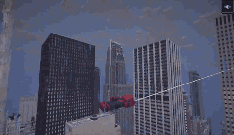

# Spider-Man for Horizon



Web swinging, zips, wall running and parkour for [Horizon](https://github.com/horizon-rust/horizon), Minecraft: Java
Edition rewritten in Rust. Tuned against Marvel's Spider-Man 2 gameplay: momentum carries from swing to swing, walls
are floors, rooftops are runways.

A native Horizon mod, built from source by the Horizon launcher, plus a WebAssembly build of the same code. Fan-made.
Not affiliated with Marvel, Sony Interactive Entertainment, Insomniac Games, Mojang or Microsoft.

## Play it

You need the [Horizon launcher](https://github.com/horizon-rust/horizon) (0.2.31 or later) and a Microsoft account
that owns Minecraft: Java Edition.

1. In the launcher open **Mods**, search **Spider-Man** and press **Install**. Until the registry lists it, use
   **Add from GitHub** on the same page with this repository's link instead:
   `https://github.com/wyddy7/minecraft-spider-man-rust` (or `horizon-launcher mods add-github <link>
   --trust-native-code`).
2. The launcher builds the mod into the game. The first build downloads the launcher's own Rust and Horizon's
   source, then compiles: a few minutes.
3. Press Play, press **F5** for third person, find something tall, hold **R** and jump.

Native mods are **not sandboxed**: the code runs with your rights, which is why the launcher asks you to trust it.
The whole mod is in [`native/mixins/spider_man/`](native/mixins/spider_man/); read it first. It is made for one
Horizon Nightly (pinned in [`native/compatibility.json`](native/compatibility.json)), and the launcher builds exactly
that version, in an instance of its own. Tested on macOS and Windows 11. More in
[native/README.md](native/README.md#install-with-the-horizon-launcher).

## Controls

| Input | Does |
|---|---|
| hold **R** in the air | web: it flies for a moment, then a pendulum swing over the street; A/D lean the anchor to a side, W pumps |
| hold **R** on the ground | the parkour run (no web): with W, a run about twice the sprint, obstacles vaulted; jump (Space) or run off an edge with R still held and the web goes |
| release **R** | let go: a boost (more on the upswing), a forward flip, a spread-eagle fall |
| hold **Z** | zip to the crosshair (reach 250), riding an arc to the point and hanging there while Z is held; let go to hop on |
| **Space** | on a web: held swings faster, let go jumps off · on a zip: held hauls, let go jumps off · at the zip point: launch · on a wall: kick off |
| into a wall with **R** held | on the wall: WASD walk it like a floor, relative to the camera; R held runs (up, with no other key), so does sprint; nothing held clings; Space kicks off; the top edge is vaulted |
| **R** + **W** into an obstacle | parkour by its height: a step or speed vault (1 block), a hand vault (2), a run up the face (3–5); long tops are landed on and run across. Without R the ground plays as vanilla |

A chase camera follows the swing and shakes at speed; the wind gets louder the faster you go. Falls from a swing
don't hurt.

R and Z can be changed, and the web delay set (how long a web flies before it bites), on the mod's page:
Options > Mods > Spider-Man > Settings. The same page turns the mod off. Chat: `/swingmode on|off`, `delay 0..2`,
`view side|front|back|off` (a fixed camera for looking at the poses) and `debug` (what the mod sees).

It plays in single player and in a LAN world you host. On someone else's server it does nothing: it only moves the
player where the server is yours. A city map makes the most of it; for the look, any Spider-Man skin.

## Status

0.2.3: the native build has everything above, on Horizon's Nightly of 2026-11-08. Multiplayer on servers is the
plan, the way movement mods do it: the server runs the mod too and lets its players swing.

## For mod authors

Horizon's native mods are new, and its documentation covers the tooling: [horizon-mixins](https://github.com/horizon-rust/horizon-mixins)
and its [template](https://github.com/horizon-rust/horizon-native-mod-template). This repository is a working mod
that goes past the template's one hook; things it shows that aren't written down there:

- **Drawing in the world.** The web strands are a HEAD hook on the game's lead (leash) geometry pushing quads into
  the same vertex list; the posed player model is a cancellable HEAD on `player_model_geometry` that draws the body
  itself through the public `mobs::anim` and `mobs::render` API and leaves every other case to the game.
- **Live reload while developing.** A native mod is compiled into the game, but `forbid(unsafe_code)` binds only
  the crate that declares it: a small dev-only crate loads the mod's logic as a library and reloads it when it
  changes. Edit, save, and the running game has it in about a second. The shipped bundle compiles the same logic in.
- **Porting a WebAssembly mod unchanged.** A facade with the mod SDK's names serves the SDK calls from the hooks'
  data, so the existing `src/` builds as either.
- **Hook targets that work.** horizon-mixins' rules (no HEAD over a body with a macro, no BEFORE_CALL in one with
  `?`, no RETURN in one with a closure) rule out many of the game's obvious functions, the level tick and the
  model animation among them. [native/README.md](native/README.md#hooks) lists the Horizon functions this mod
  hooks and what each hook does.
- **Turning the whole view.** The view matrix is built in Horizon's render crate, which the game's library
  depends on. A bundle can add a `pub` module to a library file there (`horizon-client-render/src/camera.rs`) and
  a cancellable HEAD on `view_matrix`: the game side stores the frame's yaw, pitch and turned orientation, and the
  hook returns the turned view for exactly those angles, so the world, its culling, the sky and reflections turn
  together while previews and other cameras stay as they are.
- **Your own world, not someone else's server.** Checking the connection's address isn't enough; the mod also
  requires the game's own server thread to be running.
- **A panic in the mod's logic doesn't take the game down**, and doesn't set off Horizon's crash reporter (the
  hooks themselves are kept simple instead: a panic there is still a game crash).
- **Sound.** Horizon updates a playing sound's volume only for ticking sounds: a loop whose loudness follows speed
  has to be one.

Horizon's stable hook points for native mods (`native_hooks.rs`) carry what they can: the chat commands, the mod's
row and settings page in Options > Mods with its rebindable keys, the on/off switch and the camera shake. Movement,
the camera, the fall and drawing in the world have no hook point, so they are the mod's own hooks, and the mod pins
one Horizon commit.

How to build both bundles, the development loop and the hook list: [native/README.md](native/README.md).

## WebAssembly build (0.1.0)

The first version runs in Horizon's mod sandbox on an experimental `motion` capability proposed upstream and not
merged, so it needs Horizon built from the fork [`wyddy7/horizon`](https://github.com/wyddy7/horizon), branch
`motion-api`. You need Rust (stable, via rustup) with the `wasm32-unknown-unknown` target.

```sh
# Horizon with the motion capability, beside this repo
git clone -b motion-api https://github.com/wyddy7/horizon
cd horizon
cargo build --profile fast -p horizon-client --features mods
cargo build --profile fast -p cargo-horizon-mod
cd ..

# The mod
git clone https://github.com/wyddy7/minecraft-spider-man-rust
cd minecraft-spider-man-rust
../horizon/target/fast/cargo-horizon-mod horizon-mod build   # target/horizon-mod/swing.hmod

# Play it as a dev mod (reloaded whenever you rebuild it)
cd ../horizon
./target/fast/horizon-ctl launch --world <World> --dev-mod ../minecraft-spider-man-rust/target/horizon-mod/swing.hmod
```

On that build R and Z are in Options › Controls › Key Binds under "Spider-Man", and Options › Mods › Spider-Man ›
Settings has the web delay.

## How it works

`src/lib.rs` holds the entry points, keys, camera and commands; `src/spidey.rs` the movement (swing, zip, wall run,
parkour, poses); `src/sense.rs` the rays the mod asks the game to cast each tick (anchor fan, walls, the ground
ahead). The mod drives the player's velocity itself from the first web until the feet touch the ground, so speed
carries from one swing to the next. Everything it does to the player — velocity, the fall, the model's pose, ropes,
the chase camera and wind — goes through one narrow interface: the `motion` capability in the WebAssembly build,
the hooks in `native/` in the native one.

## Contributing

Pull requests only; see [CONTRIBUTING.md](CONTRIBUTING.md).

## License

[MIT](LICENSE).
